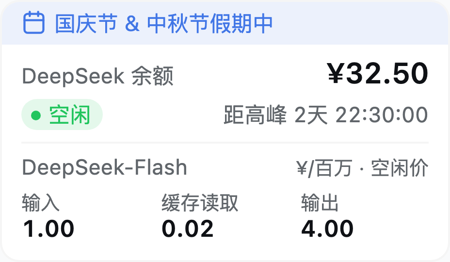
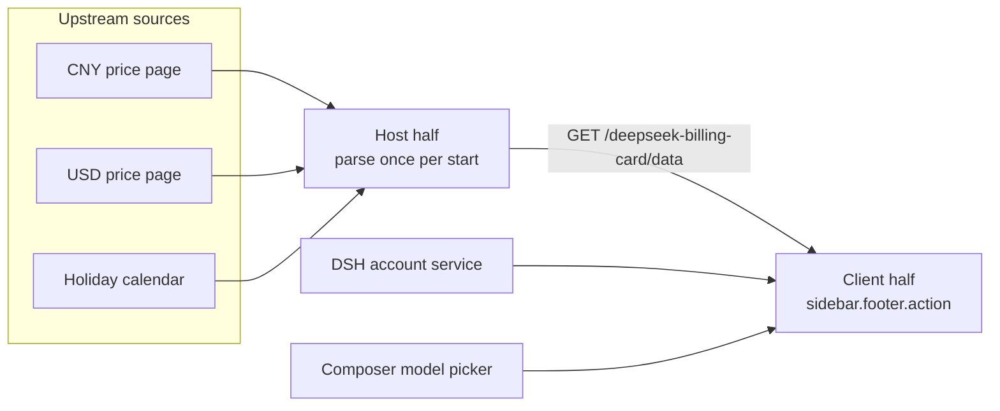

<!-- prettier-ignore -->
<div align="center">


# dsh-billing-card

*DeepSeek balance, live unit prices and the billing window, in your DSH sidebar*


[](LICENSE)

**English** · [简体中文](README.zh-CN.md)

[Features](#features) • [Screenshots](#screenshots) • [Installation](#installation) • [Usage](#usage) • [How it works](#how-it-works) • [Limits](#limits) • [Development](#development)

</div>

A plugin for the DSH (DeepSeek Harness) Web GUI that puts a compact billing card at the bottom of the sidebar. It answers three questions at a glance: **how much credit is left**, **what the selected model costs right now**, and **whether this instant is billed at peak or off-peak — and for how long**.

The card never guesses money. Prices come from the official DeepSeek documentation, the balance comes from the DSH account service, and anything that cannot be fetched falls back to a built-in copy instead of a plausible number.

> [!TIP]
> Everything the card shows is already in memory after one startup fetch: the Host half reads the upstream sources once, and the GUI reads its own loopback route. No request in the sidebar ever waits for the network.

<div align="center">
  
</div>

## Features

- **Balance you can trust** — recharge plus bonus wallets, summed as decimal strings (never floats) and truncated to the cent, so the card cannot show credit the account does not hold. Wallet-by-wallet detail lives in the tooltip.
- **The price of the model you picked** — input, cache read and output, in the tier active right now. Switching models in the composer repaints the prices immediately, without waiting for the next poll.
- **Billing period with a countdown** — green `空闲` / yellow `高峰`, next to the exact time until the switch.
- **Statutory-holiday banner** — in the Chinese UI, a holiday turns the top of the card into a light blue strip naming the occasion: `国庆节假期中`, or `国庆节 & 中秋节假期中` when two holidays share a day.
- **Make-up workday chip** — a gray `调休` chip that explains why a working Saturday is still billed as off-peak.
- **Currency follows the interface language** — a Chinese UI quotes the official CNY table, every other language the official USD table. Nothing is converted.
- **Follows the app** — colors come from DSH theme tokens, so light and dark themes both work; all visible text comes from the DSH locale service (zh/en dictionaries with identical key sets) and numbers format per locale.
- **Degrades quietly** — a missing route, an offline start or a reformatted documentation page falls back to built-in copies, never to half a table.

## Screenshots

Real renders of the shipped component, 256 px sidebar at 2× density.

| Holiday banner — `国庆节` | Make-up workday — `调休` |
| --- | --- |
|  |  |

| Two holidays on one day — `国庆节 & 中秋节` | English UI, USD prices |
| --- | --- |
|  |  |

Dark theme: [holiday banner](docs/preview-holiday-dark.png) — the blue follows `--dsw-alias-button-info-fill`, so it brightens with the dark palette.

## Installation

The plugin is published on npm as a DSH bundle, so a profile installs it by package name. Replace `web` with the profile you actually run (`desktop` for the desktop app, `web` for `dsh web`):

```bash
dsh plugin --profile web add @jimmyzm/dsh-billing-card
```

That is the same operation as **Install from npm** on the DSH plugin page, and as `plugin_manager install_bundle target=@jimmyzm/dsh-billing-card` from an agent session: pnpm adds the package to the profile and the bundle is added to `dsh.profile.bundles`.

Refresh the Web GUI afterwards. The card appears at the bottom of the sidebar, below any other footer action and above the account row, and hides itself while the sidebar is collapsed to the icon rail.

> [!IMPORTANT]
> The Host half of a DSH plugin is loaded once per application start, so **restart the application after installing or upgrading**. Until you do, the card runs on its built-in copies of the price tables and the holiday calendar — same layout and behavior, only the tooltips say "built-in snapshot".

Requirements: a DSH build with the Web GUI (the `webServer` service), the sidebar footer slot, and the account remote (`remote.account`). To uninstall:

```bash
dsh plugin --profile web remove @jimmyzm/dsh-billing-card
```

## Usage

Nothing to configure — the card reacts to what already exists in the app.

| What you do | What the card does |
| --- | --- |
| Restart the app | Fetches both price tables and the holiday calendar once, then serves them from its loopback route |
| Pick another model in the composer | Repaints the price row for that model's tier; a model the official table does not list shows `No official price for this model` and leaves the cells empty |
| Hover the balance | Lists every wallet, recharge and bonus, with its exact amount |
| Hover the tier label or a chip | Says whether the prices are `synced at startup` or a `built-in snapshot`, and whether the holidays come from the calendar or the built-in table, including the price date |
| Wait | Balance and model catalog refresh every 30 s, the countdown ticks every second |
| Switch the interface language | Chinese quotes CNY (`¥/百万`), every other language quotes USD (`$/M`) |
| Switch the app theme | Colors follow the DSH tokens, no restart |

> [!NOTE]
> On a make-up workday the period chip still reads `空闲`: the official window is Monday to Friday, and weekends are idle all day. The gray `调休` chip explains that state instead of changing it.

## How it works

The plugin is two halves that talk over one same-origin route.

**Host half** ([`index.js`](index.js), [`parse.js`](parse.js)) — at activation, once per application start, it fetches the upstream sources with an 8 s timeout, parses them, and keeps the result in memory. `GET /deepseek-billing-card/data` answers from that memory, so the GUI never waits for the network. The route is registered through a nested `ctx.inject(['webServer'], …)`: a deployment without a web server — or one where the server activates later — still loads the card, and the route appears and disappears with the server.

**Client half** ([`client.js`](client.js)) — a React component registered in `sidebar.footer.action`, with no build step, so a page refresh picks up changes immediately. It reads the route on mount (asking again every 3 s while the Host is still fetching, and a few times if the route is not there yet), measures the footer row to sit under whatever action precedes it, and renders.



### Billing window

Peak is **Beijing time, Monday to Friday, 09:00–12:00 and 14:00–18:00, excluding Chinese statutory holidays**; everything else is off-peak and billed at half the peak price, as the official table documents.

- Beijing is UTC+8 all year, so the arithmetic is plain UTC milliseconds plus a constant offset — the machine's own time zone never matters.
- The countdown does not add hours. It probes the 09:00 / 12:00 / 14:00 / 18:00 boundaries one by one and reports the first instant where the period changes, so weekends, long holiday runs and the first day back all fall out correctly.
- Days off come from the calendar; a year the calendar has not published yet simply has no holidays, and its weekdays follow the weekday windows.

### Currency

| Interface language | Price table | Unit label |
| --- | --- | --- |
| Chinese (`zh`, `zh-CN`, `zh-Hans`, …) | CNY page | `¥/百万` |
| Everything else (`en`, and any future language) | USD page | `$/M` |

> [!WARNING]
> The two tables are fetched and fallen back **independently**, and nothing is converted: the card has no exchange rate and does not invent one. A broken English page never turns dollar prices into yuan prices, or the reverse.

The balance is not converted either, so outside a Chinese card it spells its ISO code next to the symbol — `CNY ¥32.50` — because the prices beside it are dollars. A USD wallet shows `USD $7.50` in either language, and an amount below one cent renders as `CNY under 0.01`. USD prices need a third decimal (`$0.003`), so price cells print two decimals and add the third only when the amount needs it.

### Holiday banner and make-up label

Both are Chinese-UI only — the calendar names its days in Chinese, and an English card showing them would mix languages.

- **Banner** — on a statutory holiday the top of the card becomes a full-width light blue strip: a calendar glyph, the occasion, then `假期中`. Two occasions on one day read `国庆节 & 中秋节假期中`. Long names ellipsize; the tooltip carries the full name and the calendar source.
- **Chip** — on a make-up workday a gray `调休` chip sits next to the period chip, tooltipped with the occasion and the off-peak wording.
- Neither appears on an ordinary day, and the two never appear together.

### Data sources

| What | Source |
| --- | --- |
| Balance | `ctx.remote.account.getBalance(...)` — recharge and bonus wallets from the DSH account service |
| Selected model | `ctx.modelDirectories.directoryFor(sessionId).store`, the store the composer's model picker writes; falls back to `ctx.remote.session.modelCatalog().default` |
| Unit prices (CNY) | <https://api-docs.deepseek.com/zh-cn/quick_start/pricing/> |
| Unit prices (USD) | <https://api-docs.deepseek.com/quick_start/pricing/> |
| Billing period | Built-in peak windows + <https://calendars.icloud.com/holidays/cn_zh.ics> (`（休）` days off and `（班）` make-up days, each with its occasion) |

The ICS feed expands `DTSTART`–`DTEND` (exclusive end, single-day events tolerated), keeps both names when two ranges cover one day, and prefers a day off over a make-up entry for the same day.

### Fallbacks

| Source | Built-in copy |
| --- | --- |
| CNY price table | `PRICE_SNAPSHOT.CNY`, read on 2026-10-26 |
| USD price table | `PRICE_SNAPSHOT.USD`, read on 2026-10-26 |
| Holiday calendar | `HOLIDAY_RANGES` + `MAKEUP_DAYS`, covering 2025–2026 with names |

A source that fails to parse — page redesign, offline start, non-2xx, timeout — falls back whole: the Host logs one warning and marks the source in the route's `sources` field. The route also reports when it last fetched.

```json
{
  "status": "ready",
  "at": "2026-10-26T02:00:00.000Z",
  "sources": { "pricing.CNY": "ready", "pricing.USD": "ready", "calendar": "ready" },
  "prices": {
    "CNY": { "asOf": "2026-10-26", "currency": "CNY", "models": {} },
    "USD": { "asOf": "2026-10-26", "currency": "USD", "models": {} }
  },
  "holidays": {
    "days": [20727], "names": { "20727": "国庆节" },
    "makeup": [20731], "makeupNames": { "20731": "国庆节" },
    "years": [2023, 2024, 2025, 2026]
  }
}
```

Dates are Beijing day numbers (days since the epoch). The route carries public pricing and holiday data only — never account information.

## Limits

- Prices and holidays are calibrated **once per application start**. A long-running app keeps the prices it started with; the next start picks up a price change or a newly published year.
- Nothing is converted between currencies, and the balance keeps its wallet currency.
- A `调休` day is deliberately still off-peak (see above).
- Years the calendar has not published (2027 onward today) have no holidays, so their weekdays follow the weekday windows.
- The card needs a same-origin HTTP GUI (`dsh web`); opened from `file://`, or without a `webServer` service, it runs on the built-in copies.
- Live model following needs the optional `uiSession` and `modelDirectories` Client services. Without them the card prices the catalog default and refreshes every 30 s — still correct, just not instant.

## Development

There is no build step: `client.js` is a hand-written browser module (`window.__ModuleLoader__`), while `index.js` and `parse.js` are the Host half. The card renders only its own subtree and reads only `--dsw-alias-*` tokens, so it cannot restyle the host or another plugin.

```
package.json        # dsh.bundle.patch + dsh.client (platform: web)
cordis.patch.yml    # inserts the dsh-billing-card entry
index.js            # Host half: fetch once per start + GET /deepseek-billing-card/data
parse.js            # Host parsers: bilingual price tables, ICS holiday calendar
client.js           # Client half: the card, built-in fallbacks, billing window
locale/{zh,en}.json # plugin title/description for the plugin manager
icon.svg
docs/               # screenshots, the header icon, the previous Chinese README
README.md           # this file
README.zh-CN.md     # Chinese README
LICENSE
```

To run your own checkout instead of the published package, pass the folder — pnpm links it into the profile, so `client.js` edits show up on a page refresh and `index.js` / `parse.js` edits after a restart:

```bash
dsh plugin --profile web add /path/to/dsh-billing-card
```

To exercise the parsers without the GUI, run them straight from Node:

```bash
node -e "import('./parse.js').then(async (m) =>
  console.log(m.parseHolidayCalendar(await (await fetch(m.HOLIDAY_URL)).text()).names))"
```

Released under the [MIT license](LICENSE).
