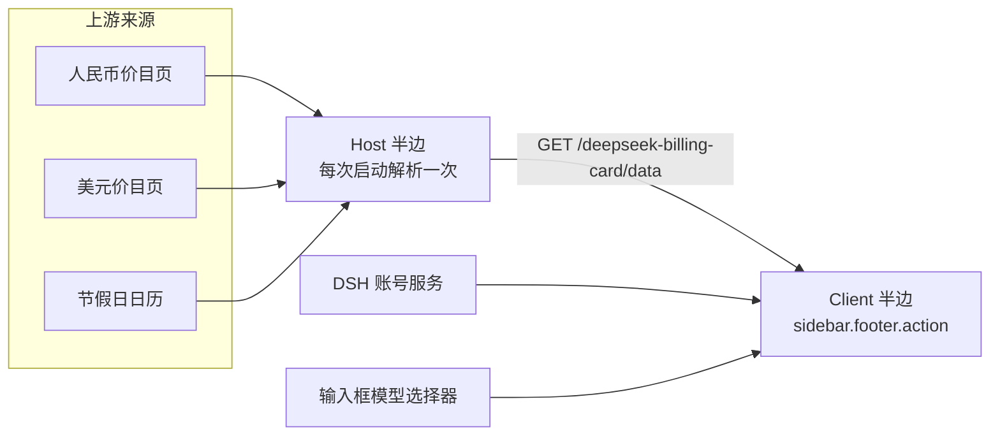

<!-- prettier-ignore -->
<div align="center">


# dsh-billing-card

*DSH 侧边栏里的 DeepSeek 余额、实时单价与计费时段*


[](LICENSE)

[English](README.md) · **简体中文**

[功能](#功能) • [截图](#截图) • [安装](#安装) • [使用](#使用) • [工作原理](#工作原理) • [已知边界](#已知边界) • [开发](#开发)

</div>

一个 DSH（DeepSeek Harness）Web GUI 插件，在侧边栏底部放一张紧凑的计费卡片，一眼回答三个问题：**还剩多少额度**、**当前选中模型此刻多少钱**、**这一刻是高峰还是空闲，还有多久切换**。

卡片不猜钱：价格来自 DeepSeek 官方文档，余额来自 DSH 账号服务，抓不到的东西一律回退到内置副本，而不是编一个看起来合理的数字。

> [!TIP]
> 卡片显示的一切在启动抓取之后都已在内存里：Host 半边只读一次上游，界面读自己的本机路由。侧边栏里的任何一次刷新都不用等网络。

<div align="center">
  
</div>

## 功能

- **可信的余额** —— 充值钱包 + 赠金钱包，用字符串十进制相加（不走浮点）再按「分」截断，卡片不会显示账号里并不存在的额度；每个钱包的明细在悬停提示里。
- **选中模型的单价** —— 输入 / 缓存读取 / 输出，取此刻生效的档位。在输入框里换模型，价签立即重绘，不用等下一轮轮询。
- **计费时段与倒计时** —— 绿色「空闲」/ 黄色「高峰」，旁边是距切换的精确时间。
- **法定节假日横条** —— 中文界面下，节假日会把卡片顶部变成一条淡蓝色横条写明是什么假期：`国庆节假期中`；一天两个假期时读作 `国庆节 & 中秋节假期中`。
- **调休标签** —— 灰色「调休」，解释为什么一个上班的周六仍按空闲计费。
- **币种跟随界面语言** —— 中文界面用官方人民币价目，其余语言用官方美元价目，互不换算。
- **跟随应用** —— 颜色只取 DSH 主题 token，亮暗主题都成立；可见文案来自 DSH locale 服务（zh / en 两套键集一致的字典），数字格式随语言。
- **静默降级** —— 路由缺失、离线启动、文档改版时回退到内置副本，绝不显示半张表。

## 截图

真实组件渲染，256 px 侧边栏、2 倍像素密度。

| 假期横条 —— `国庆节` | 调休工作日 —— `调休` |
| --- | --- |
|  |  |

| 一天两个假期 —— `国庆节 & 中秋节` | 英文界面 / 美元价目 |
| --- | --- |
|  |  |

暗色主题：[假期横条](docs/preview-holiday-dark.png) —— 蓝色取 `--dsw-alias-button-info-fill`，在暗色调色板里自动变亮。

## 安装

插件已发布到 npm，是一个 DSH bundle，按包名装进 profile 即可。`--profile` 写你实际在跑的那个 profile（桌面应用是 `desktop`，`dsh web` 是 `web`）：

```bash
dsh plugin --profile web add @jimmyzm/dsh-billing-card
```

这等价于 DSH 插件页里的「从 npm 安装」，也等价于在 agent 会话里执行 `plugin_manager install_bundle target=@jimmyzm/dsh-billing-card`：pnpm 把包装进 profile，同时把该 bundle 加入 `dsh.profile.bundles`。

装完刷新 Web GUI：卡片出现在侧边栏底部，排在该行已有动作之下、账号行之上；侧边栏收起成图标栏时自动隐藏。

> [!IMPORTANT]
> DSH 插件的 Host 半边只在应用启动时加载一次，所以**安装或升级后要重启一次应用**。在重启之前，卡片用的是内置的价目表与节假日副本 —— 布局与行为完全一致，只是悬停提示写「内置快照」。

依赖：带 Web GUI（`webServer` 服务）、带侧边栏底槽位、带账号 remote（`remote.account`）的 DSH 构建。卸载：

```bash
dsh plugin --profile web remove @jimmyzm/dsh-billing-card
```

## 使用

不需要配置 —— 卡片只对应用里已有的事情作出反应。

| 你做的事 | 卡片做的事 |
| --- | --- |
| 重启应用 | 抓一次两个价目页与节假日日历，之后从本机路由作答 |
| 在输入框里换模型 | 按该模型的档位重绘价格行；官方价目未收录的模型显示「官方价目未收录该模型」并留空价格区 |
| 悬停余额 | 逐行列出每个钱包（充值、赠金）与精确金额 |
| 悬停档位标签或标签 | 说明价目是「启动时校准」还是「内置快照」、节假日来自日历还是内置表，并给出价目日期 |
| 等待 | 余额与模型目录每 30 秒刷新，倒计时每秒跳一次 |
| 切换界面语言 | 中文报人民币（`¥/百万`），其余语言报美元（`$/M`） |
| 切换应用主题 | 颜色跟随 DSH token，无需重启 |

> [!NOTE]
> 调休上班日的时段标签仍然是「空闲」：官方窗口是周一至周五，周末全天空闲。灰色「调休」标签只是解释这个状态，而不是改变它。

## 工作原理

插件是两个半边，靠一条同源路由通信。

**Host 半边**（[`index.js`](index.js)、[`parse.js`](parse.js)）—— 激活时（每次应用启动一次）带 8 秒超时抓取上游，解析后留在内存里。`GET /deepseek-billing-card/data` 从内存作答，界面因此从不等网络。路由用嵌套的 `ctx.inject(['webServer'], …)` 注册：没有 Web 服务、或 Web 服务晚于卡片激活的部署里，卡片照常加载，路由随服务出现与消失。

**Client 半边**（[`client.js`](client.js)）—— 注册在 `sidebar.footer.action` 的一个 React 组件，没有构建步骤，刷新页面即生效。挂载时读那条路由（Host 还在抓取时每 3 秒再问一次，路由尚未出现时也会重试几次），测量底部动作行让自己落在前一个动作下方，然后渲染。



### 计费窗口

高峰 = **北京时间周一至周五 9:00–12:00、14:00–18:00，且不含中国法定节假日**；其余全部空闲，按官方说明以高峰价的一半计费。

- 北京时间固定 UTC+8，所以计算就是 UTC 毫秒加一个常量偏移，与本机时区无关。
- 倒计时不是「加上若干小时」，而是逐个试探 9/12/14/18 四个边界，报告第一个时段发生变化的时刻，因此周末、连休、节后首日都自动正确。
- 放假日期来自日历；日历尚未发布的年份没有任何节假日，其中的工作日按周一至周五的窗口计费。

### 币种

| 界面语言 | 价目表 | 单位写法 |
| --- | --- | --- |
| 中文（`zh`、`zh-CN`、`zh-Hans`……） | 人民币页 | `¥/百万` |
| 其余语言（`en`，以及将来新增的语言） | 美元页 | `$/M` |

> [!WARNING]
> 两张表**各自抓取、各自回退**，且不做任何换算：卡片没有汇率，也不凭空造一个。英文页坏掉不会把美元价变成人民币价，反之亦然。

余额同样不换算，所以非中文卡片会在符号旁写清 ISO 代码 —— `CNY ¥32.50` —— 因为它旁边的单价是美元。美元钱包在两种语言下都显示 `USD $7.50`，不足一分显示 `CNY under 0.01`。美元价需要第三位小数（`$0.003`），所以价格固定两位、必要时才用第三位。

### 假期横条与调休标签

两者都只在中文界面出现 —— 日历里的假期名是中文，显示在英文卡片里会串语言。

- **横条** —— 法定节假日时，卡片顶部整条变成淡蓝色：日历图标 + 假期名 + `假期中`。一天两个假期读作 `国庆节 & 中秋节假期中`。名字过长省略号截断，悬停给出完整假期名与日历来源。
- **标签** —— 调休上班日时，「空闲 / 高峰」旁多一个灰色「调休」，悬停写明属于哪个假期以及仍按空闲计费。
- 普通日子两个都不出现，且两者不会同时出现。

### 数据来源

| 内容 | 来源 |
| --- | --- |
| 余额 | `ctx.remote.account.getBalance(...)` —— DSH 账号服务的充值钱包与赠金钱包 |
| 当前模型 | `ctx.modelDirectories.directoryFor(sessionId).store`，与输入框模型选择器同一个 store；没有可见会话时回落 `ctx.remote.session.modelCatalog().default` |
| 单价（人民币） | <https://api-docs.deepseek.com/zh-cn/quick_start/pricing/> |
| 单价（美元） | <https://api-docs.deepseek.com/quick_start/pricing/> |
| 计费时段 | 内置高峰窗口 + <https://calendars.icloud.com/holidays/cn_zh.ics>（`（休）` 放假、`（班）` 调休，事件自带假期名） |

ICS 按 `DTSTART`–`DTEND` 展开（结束为开区间，兼容单日事件），一天被两个日期段覆盖时保留两个名字，同一天既是放假又是调休时按放假算。

### 回退

| 来源 | 内置副本 |
| --- | --- |
| 人民币价目表 | `PRICE_SNAPSHOT.CNY`，读取于 2026-10-26 |
| 美元价目表 | `PRICE_SNAPSHOT.USD`，读取于 2026-10-26 |
| 节假日日历 | `HOLIDAY_RANGES` + `MAKEUP_DAYS`，覆盖 2025–2026，带假期名 |

某个来源解析失败（页面改版、离线启动、非 2xx、超时）时整份回退：Host 记一条 warn，并在路由的 `sources` 里标明；路由同时给出这次抓取的时间。

```json
{
  "status": "ready",
  "at": "2026-10-26T02:00:00.000Z",
  "sources": { "pricing.CNY": "ready", "pricing.USD": "ready", "calendar": "ready" },
  "prices": {
    "CNY": { "asOf": "2026-10-26", "currency": "CNY", "models": {} },
    "USD": { "asOf": "2026-10-26", "currency": "USD", "models": {} }
  },
  "holidays": {
    "days": [20727], "names": { "20727": "国庆节" },
    "makeup": [20731], "makeupNames": { "20731": "国庆节" },
    "years": [2023, 2024, 2025, 2026]
  }
}
```

日期是北京时间日序号（自 epoch 起的天数）。路由只送公开的价目与节假日，不含任何账号信息。

## 已知边界

- 价目与节假日**每次应用启动校准一次**。长期不重启的应用会继续用启动时的那份；价格变化或新一年的安排在下一次启动时跟进。
- 币种之间不换算，余额保持钱包自身的币种。
- `调休` 日刻意保持空闲（见上）。
- 日历尚未发布的年份（目前 2027 及以后）没有节假日，其中的工作日按周一至周五的窗口计费。
- 卡片需要同源 HTTP 界面（`dsh web`）；从 `file://` 打开、或没有 `webServer` 服务时，它用内置副本运行。
- 实时模型跟随依赖可选的 `uiSession` 与 `modelDirectories` 两个 Client 服务。没有它们时卡片按目录默认值标价、每 30 秒刷新一次 —— 数值仍然正确，只是不再即时。

## 开发

没有构建步骤：`client.js` 是手写的浏览器模块（`window.__ModuleLoader__`），`index.js` 与 `parse.js` 是 Host 半边。卡片只渲染自己的子树、只读 `--dsw-alias-*` token，因此不会改到宿主或别的插件。

```
package.json        # dsh.bundle.patch + dsh.client（platform: web）
cordis.patch.yml    # 插入 dsh-billing-card 一行
index.js            # Host 半边：启动抓取一次 + GET /deepseek-billing-card/data
parse.js            # Host 解析器：中英价目表、ICS 日历
client.js           # Client 半边：卡片、内置副本、计费窗口
locale/{zh,en}.json # 插件标题/描述（插件管理界面用）
icon.svg
docs/               # 截图、头部图标、上一版中文 README
README.md           # 英文 README
README.zh-CN.md     # 本文件
LICENSE
```

想跑本地这份代码而不是 npm 上的包，直接把目录交给它 —— pnpm 会把它 link 进 profile，因此改 `client.js` 刷新页面即生效，改 `index.js` / `parse.js` 重启后生效：

```bash
dsh plugin --profile web add /path/to/dsh-billing-card
```

不开 GUI 也可以直接跑解析器验证：

```bash
node -e "import('./parse.js').then(async (m) =>
  console.log(m.parseHolidayCalendar(await (await fetch(m.HOLIDAY_URL)).text()).names))"
```

以 [MIT 许可](LICENSE) 发布。
