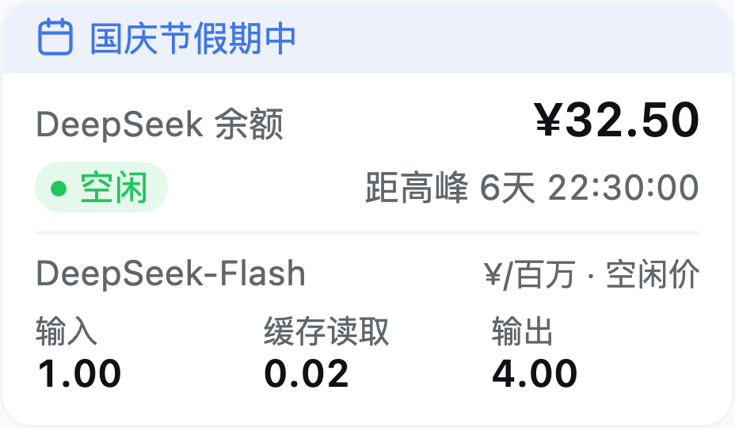
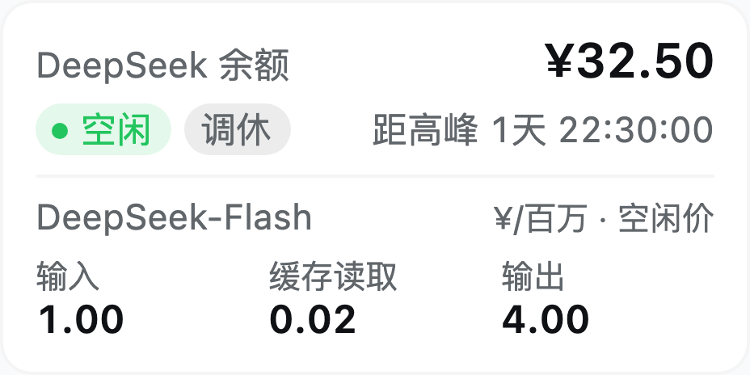
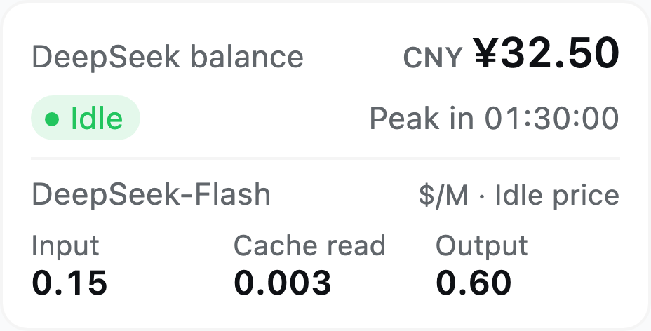
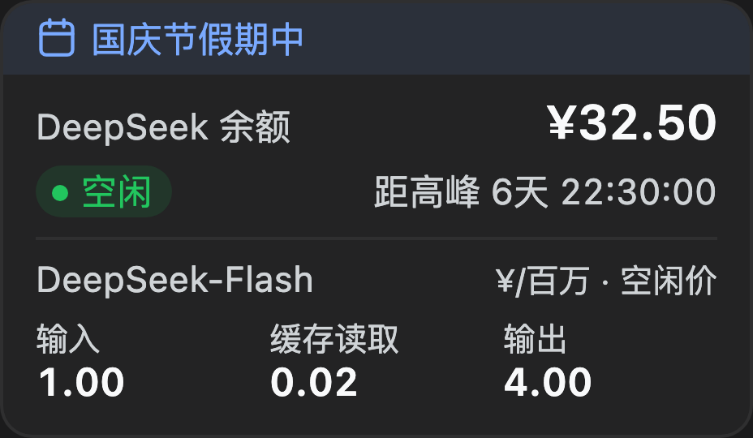

<!-- prettier-ignore -->
<div align="center">


# dsh-billing-card

*DSH 侧边栏里的 DeepSeek 余额、实时单价与计费时段*


[](https://npmx.dev/package/@jimmyzm/dsh-billing-card)
[](LICENSE)
[](https://npmx.dev/package/@jimmyzm/dsh-billing-card)
[](https://github.com/Jimmyzm/dsh-billing-card/actions/workflows/ci.yml)
[](https://github.com/deepseek-ai/deepseek-harness)

[English](README.md) · **简体中文**

[功能](#功能) • [截图](#截图) • [安装](#安装) • [工作原理](#工作原理) • [已知边界](#已知边界) • [开发](#开发)

</div>

DSH（DeepSeek Harness）侧边栏底部的一张卡片：还剩多少额度、当前选中模型此刻多少钱、这一刻是高峰还是空闲以及还有多久切换。

价格来自 DeepSeek 官方文档，余额来自 DSH 账号服务；卡片不猜数据，抓不到就回退到内置副本。

> [!TIP]
> 卡片在启动时抓取一次，之后从内存作答，侧边栏里的任何刷新都不用等网络。

<div align="center">
  
</div>

## 功能

- **余额** —— 充值钱包 + 赠金钱包，精确相加并按「分」截断，每个钱包的明细在悬停提示里。
- **选中模型的单价** —— 输入 / 缓存读取 / 输出，取当前生效的档位；在输入框换模型立即重绘。
- **计费时段与倒计时** —— 绿色「空闲」/ 黄色「高峰」，旁边是距切换的时间。
- **假期与调休标记** —— 中文界面下节假日显示为卡片顶部的淡蓝色横条（`国庆节假期中`），调休上班日显示灰色「调休」标签。
- **币种跟随界面语言** —— 中文报人民币，其余语言报美元；余额保持钱包自身币种。
- **跟随应用** —— 亮暗主题、中英字典、数字格式随语言，数据不可用时静默回退。

## 截图

真实渲染，256 px 侧边栏、2 倍像素密度。

| 假期 —— `国庆节` | 调休工作日 —— `调休` |
| --- | --- |
|  |  |

| 英文界面 / 美元价目 | 暗色主题 |
| --- | --- |
|  |  |

## 安装

插件已发布到 npm（[`@jimmyzm/dsh-billing-card`](https://npmx.dev/package/@jimmyzm/dsh-billing-card)），是一个 DSH bundle。`--profile` 写你实际在跑的 profile（桌面应用是 `desktop`，`dsh web` 是 `web`）：

```bash
dsh plugin --profile web add @jimmyzm/dsh-billing-card
```

等价于插件页里的「从 npm 安装」。装完刷新界面：卡片出现在侧边栏底部，侧边栏收起成图标栏时自动隐藏。

> [!IMPORTANT]
> 插件的 Host 半边只在应用启动时加载一次，所以**安装或升级后要重启一次应用**。在重启之前卡片用内置数据，布局一致，只是悬停提示写「内置快照」。

依赖带 Web GUI、侧边栏底槽位与账号服务的 DSH。卸载：

```bash
dsh plugin --profile web remove @jimmyzm/dsh-billing-card
```

## 工作原理

**Host 半边** —— 每次应用启动抓取一次中英两个价目页与大陆节假日日历，解析后在 `GET /deepseek-billing-card/data` 上作答。**Client 半边** —— 注册在 `sidebar.footer.action` 的 React 组件，读取该路由、实时跟随输入框的模型选择、每 30 秒刷新余额。没有构建步骤。

### 计费窗口

高峰 = **北京时间周一至周五 9:00–12:00、14:00–18:00，且不含法定节假日**，其余时段按空闲（半价）计费。周末全天空闲，所以调休的周六显示灰色「调休」标签而不是高峰价。

### 币种

中文界面用官方人民币价目，其余语言用官方美元价目。

> [!WARNING]
> 两张表各自抓取、各自回退，且不做任何换算 —— 卡片没有汇率，也不凭空造一个。

### 数据来源

| 内容 | 来源 |
| --- | --- |
| 余额、模型 | DSH 账号服务；输入框的模型选择 |
| 单价 | <https://api-docs.deepseek.com/zh-cn/quick_start/pricing/> 与 <https://api-docs.deepseek.com/quick_start/pricing/> |
| 节假日 | <https://calendars.icloud.com/holidays/cn_zh.ics> |

## 已知边界

- 价目与节假日每次应用启动校准一次，长期不重启的应用保留启动时的那份。
- 币种之间不换算，余额保持钱包自身币种。
- 卡片需要同源 HTTP 界面（`dsh web`）；没有 Web 服务时用内置副本运行。
- 实时模型跟随依赖可选的 `uiSession` 与 `modelDirectories` 服务，缺失时按目录默认值标价。

## 开发

没有构建步骤：`client.js` 是手写的浏览器模块，`index.js` 与 `parse.js` 是 Host 半边。卡片只渲染自己的子树、只读 `--dsw-alias-*` token，不会改到宿主。

```
package.json        # dsh.bundle.patch + dsh.client
cordis.patch.yml    # 插入 dsh-billing-card 一行
index.js parse.js   # Host 半边：启动抓取 + 数据路由
client.js           # Client 半边：卡片与内置副本
locale/  icon.svg  docs/
test/               # 离线测试：解析器、Host 路由、Client 渲染
.github/workflows/  # ci（测试）与 publish（带 provenance 发布 npm）
```

想跑本地这份代码而不是 npm 上的包，把目录交给它即可 —— 会 link 进 profile，改 `client.js` 刷新页面就生效：

```bash
dsh plugin --profile web add /path/to/dsh-billing-card
```

`npm test` 跑离线测试：解析器对 `test/fixtures` 里保存的页面、Host 路由（上游用桩）、以及 Client 半边在迷你
React 运行时里的渲染。无依赖、不联网。

以 [MIT 许可](LICENSE) 发布。
