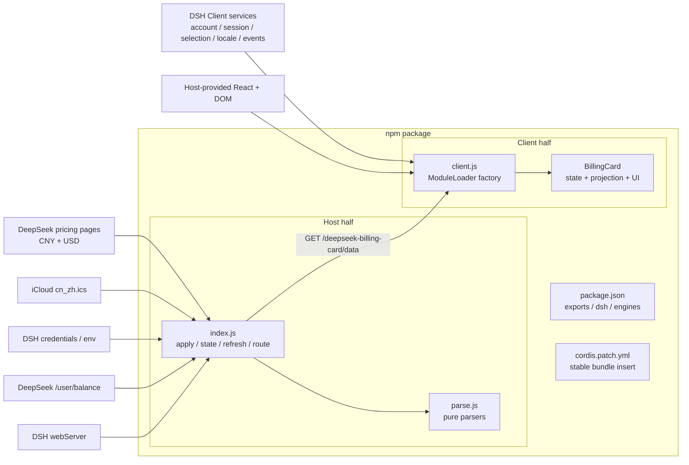
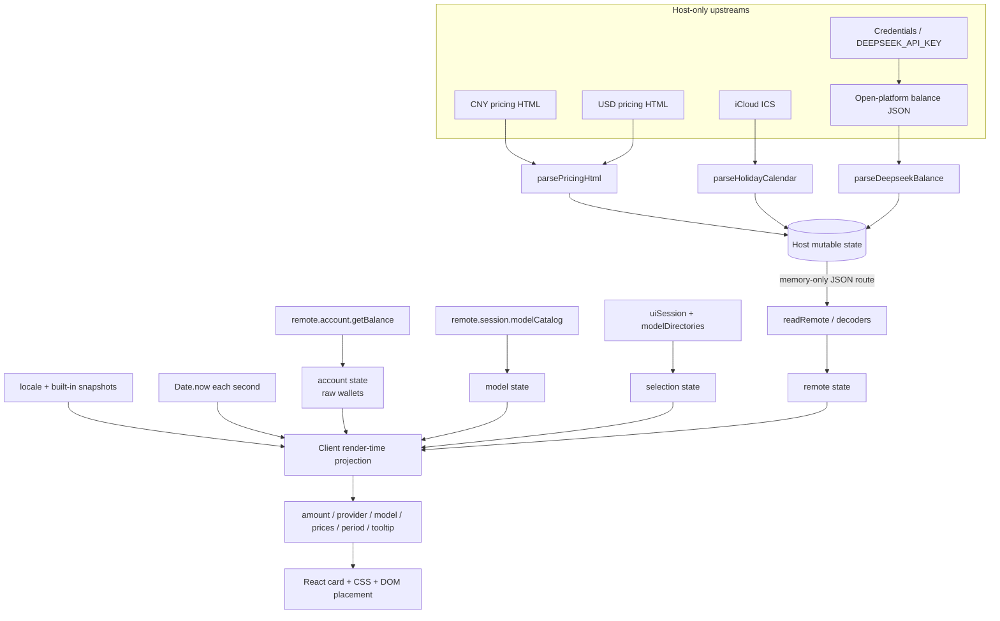
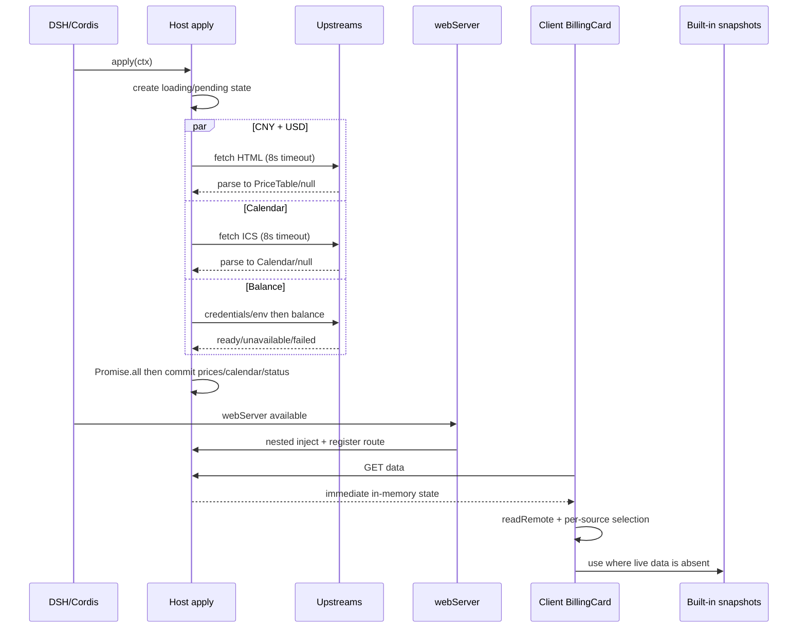
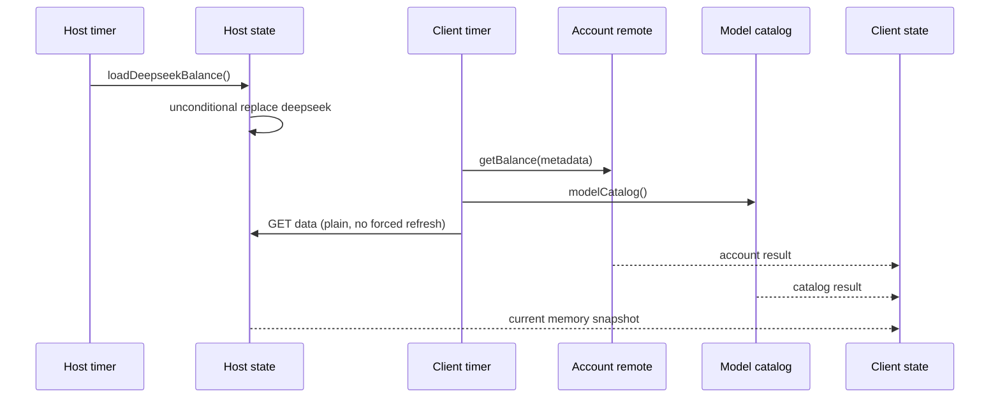

# dsh-billing-card 2.0：当前架构逆向分析

> 基线：`preview@7512286`  
> 方法：静态调用链、数据所有权、部署边界和测试对照  
> 标记：**[事实]** 可直接由代码证明；**[推断]** 架构影响判断；**[建议]** 重建方向

## 1. 架构总览

**[事实]** 当前是无构建、无 npm 运行时依赖的 Host/Client 双半 DSH 插件。Host 负责跨域采集与凭据，Client 负责 DSH 会话数据、全部卡片领域逻辑和 UI。两侧没有共享 JS 模块；HTTP 路径与 DTO 是跨半部唯一显式契约。

## 2. 模块职责与实际所有权

| 模块 | 拥有的状态／规则 | 不负责 | 证据 |
| --- | --- | --- | --- |
| `index.js` | 启动 state、来源状态、API Key、余额刷新、路由 | DSH 账号钱包、当前会话、峰谷、DOM | `index.js:99-263` |
| `parse.js` | URL 常量、价格／日历／开放平台余额 DTO 转换、北京日期字符串 | I/O、缓存、刷新、UI | `parse.js:15-48,71-101,332-454` |
| `client.js` | 内置快照、金额、峰谷、模型匹配、provider 规则、DSH 适配、轮询、视图与样式 | 跨域上游、API Key、原始 HTML/ICS | `client.js:23-1912` |
| `package.json` | 包导出、运行时文件、DSH 版本、Client 先行依赖 | 业务实现 | `package.json:27-64` |
| `cordis.patch.yml` | 稳定 bundle 插入 id | 路由、事件、业务配置 | `cordis.patch.yml:1-6` |
| `test/` | 离线行为契约与模拟宿主 | 真实 DSH／浏览器端到端证明 | `test/` |

**[事实]** `client.js` 不是普通 ESM 导出，而是顶层调用 `window.__ModuleLoader__.load`，工厂最终返回 `{inject, apply}`：`client.js:23-28,1910-1912`。

## 3. 当前数据流图

### 3.1 数据来源与去向要点

**[事实]**

- API Key 不进入路由 DTO；原始 HTML/ICS 也不跨路由。
- DSH 账号和模型目录不经过插件 Host，而由 Client 直接读取。
- 峰谷规则、倒计时、内置快照、provider 映射和金额合计只在 Client。
- 路由输出以 JSON 为终点之一；最终可见输出只有卡片、tooltip 和 Host warning 日志。
- 没有数据库、文件持久化或业务回写。

## 4. 当前业务调用链

### 4.1 启动链

**[事实]** 启动余额读取和价目／日历一起被等待，但 `Promise.all` 的第三个结果被忽略；这造成凭据故障可阻塞其它来源提交。证据：`index.js:218-234`。

### 4.2 稳定 30 秒刷新链

**[事实]** 两个 30 秒时钟没有相位同步。Client 可以读到 Host 本次刷新前的值，额外滞后取决于两边时序。

### 4.3 会话／提供商切换链

1. **[事实]** `uiSession.adapter.current` 给出可见 session，`modelDirectories.directoryFor(sessionId).store` 给出 `{provider, model}`：`client.js:1744-1828`。
2. **[事实]** `watchSelection` 立即更新 selection，并重读 DSH 账号：`client.js:723-735`。
3. **[事实]** provider 与上次不同则请求 `?balance=refresh`：`client.js:736-744`。
4. **[事实]** Host 启动后台余额读取，但立即回答旧内存状态：`index.js:80-85,196-215`。
5. **[事实]** Client 在余额未 ready 时最多两次、每秒跟进：`client.js:789-797`。
6. **[事实]** render 时 selection 覆盖 catalog.default，再决定余额和价格：`client.js:922-952,990-1106`。

### 4.4 设置／凭据变化链

**[事实]** Client 订阅 `llm/adapters-updated`、`settings/document-updated`、`credentials/record-updated`、`credentials/reference-updated`，事件只触发 API 余额刷新，不立即重读账号或模型目录：`client.js:1846-1879`。

### 4.5 每秒渲染链

**[事实]** 展开时 timer 更新 `now` → 北京日数与分钟 → 周末／休假日／窗口判断 → `nextSwitchAt` 扫描边界 → 当前 tier 和价格 → 卡片文本。折叠时该 timer 停止；重新展开会重启 timer，但没有单独的立即 `setNow` effect：`client.js:698-716`。

**[推断]** 长时折叠后展开的首帧可短暂使用旧 `now`，若跨越北京午夜或峰谷边界，旧状态可能短暂可见。

## 5. Host/Client 能力边界

| 能力 | Host | Client | 当前边界评价 |
| --- | --- | --- | --- |
| 跨域上游网络 | 全部负责 | 不直接访问 | 合理，避免 CORS 与凭据进入页面 |
| API Key | credentials/env，Bearer header | 不接触 | 明确的敏感边界 |
| 原始 HTML/ICS/余额响应 | 获取并解析 | 不接收 | 解析集中在 Host |
| DSH 账号钱包 | 不读取 | 直接 remote.account | Host BFF 能力未被证明 |
| 模型目录 | 不读取 | remote.session | 当前选择仍需 Client |
| 可见会话选择 | 不读取 | uiSession/modelDirectories | 最强 Client 专有耦合 |
| 计费窗口／倒计时 | 不计算 | 全部负责 | 每秒计算适合留在 Client |
| 内置快照 | 不持有 | 持有 | 支持无路由降级，但数据随 Client 发布 |
| 状态刷新 | 启动 + 余额 timer + 手动 | 初次重试 + 30 秒 + 事件 + 跟进 | 多触发器缺乏统一协调 |
| DOM/React/样式 | 无 | 全部负责 | 符合半部职责，但组件过大 |
| HTTP 数据服务 | 内存路由 | 同源消费 | 无 schema 版本、无共享常量 |

## 6. 当前公共与隐式 API 总览

**[事实]** 对外表面包括：

- npm exports：`.`、`./client`、`./locale/*.json`、`./icon`。
- Host ESM：`apply(ctx)`、`DATA_PATH`。
- Client loader：`inject`、`apply(ctx)`。
- HTTP：`GET/HEAD /deepseek-billing-card/data`，可选 `?balance=refresh`。
- DSH slot：`sidebar.footer.action`，id `dsh-billing-card`，order 10。
- 多个被消费的 DSH 服务形状和四个 remote 事件。

**[事实]** `parse.js` 被打包但没有 package subpath export；其函数是文件级导出，不应自动视为受支持的包级公共 API。

完整清单、DTO 和稳定性分类见 [API_INVENTORY.md](API_INVENTORY.md)。

## 7. 当前外部依赖清单

### 7.1 网络与数据依赖

| 依赖 | 用途 | 失败处理 |
| --- | --- | --- |
| `api-docs.deepseek.com/zh-cn/quick_start/pricing/` | CNY 价目 | 该表为 null，Client 回退内置 CNY |
| `api-docs.deepseek.com/quick_start/pricing/` | USD 价目 | 该表为 null，Client 回退内置 USD |
| `api.deepseek.com/user/balance` | API Key 对应余额 | failed/unavailable 通知；部分路径回退账号 |
| `calendars.icloud.com/holidays/cn_zh.ics` | 中国大陆节假日和调休 | 内置 2025–2026 日历 |

### 7.2 宿主与平台依赖

**[事实]**

- DSH 包级 Client 先行依赖：`@deepseek-ai/dsh-client-locale`、`@deepseek-ai/dsh-client-ui-sidebar`。
- Client 服务：slots、locale、timer、remote.account、remote.session；可选 uiSession/modelDirectories。
- Host 服务：可选 logger、credentials、webServer。
- React、浏览器 DOM/fetch/Intl/BigInt、Node fetch/AbortSignal/Buffer/process。
- DSH 版本声明：`>=0.2.0-rc.1 <0.3.0-0 || >=0.2.1-0 <0.3.0-0`；README 只声明在 0.2.1-rc.3 端到端验证。

### 7.3 工程与发布依赖

**[事实]** 无 npm dependencies/devDependencies；测试只用 Node 内置模块和 fixture。CI 使用 GitHub Actions、Node LTS；发布使用 npm 11 和 GitHub OIDC provenance。证据：`.github/workflows/ci.yml:15-28`、`.github/workflows/publish.yml:21-86`。

## 8. 部署和兼容边界

**[事实]**

- Host 改动需应用重启；Client 改动需页面刷新。
- 新 Client 可能连接仍在运行的旧 Host，因此路径保留旧产品名。
- 无 Web Server 时 Host 不注册路由但仍激活；Client 使用内置价目和日历，也收不到 Host 的开放平台余额。
- 老 Host 缺少 `deepseek` 字段时，开放平台 provider 会回退账号余额。
- `engines.dsh` 限定 0.2 预发布线，但服务形状主要靠运行时鸭子类型与测试 stub 保证。

**[推断]** 当前兼容策略只覆盖部分“新 Client + 旧 Host”，没有完整的“新 Host + 旧 Client”版本治理，也没有 schema 握手区分协议不支持与传输失败。

## 9. 当前主要架构问题

| 架构问题 | 证据 | 影响 |
| --- | --- | --- |
| Client 巨型工厂与组件 | `client.js:23-1912`，`BillingCard:692-1489` | 修改面大，纯规则无法直接导入测试 |
| DTO 无版本且语义不统一 | `index.js:99-113,224-233`；`client.js:1713-1725` | loading/ready、字段缺失和失败被混淆 |
| 多触发器没有统一资源协调 | `index.js:173-246`；`client.js:768-853` | 重复请求、乱序覆盖、卸载后工作 |
| 输入校验分散且不一致 | `client.js:515-524,1531-1535,1692-1705` | 原型碰撞、崩溃、少算、误标币种 |
| 业务规则与上游快照拆分 | 峰谷／单位／alias 在 Client，数字在 Host | 上游改规则时只更新数字，不更新解释 |
| UI 深依赖宿主内部布局 | `client.js:855-903,1744-1828` | DSH 内部结构变化即可破坏插件 |
| 测试 harness 与真实平台差距 | mini React、fake Cordis，无真实 DOM | 1004 断言仍不能证明几何和真实生命周期 |

## 10. 架构结论

**[推断]** 当前 Host/Client 数据获取分工总体合理，尤其“Key 和跨域只在 Host、每秒倒计时在 Client”值得保留。需要重建的是其间的版本化契约、每源状态模型和异步协调，以及 Client 内部领域／应用／UI 分层。

**[建议]** 不应把“薄 Client”简单理解为把所有逻辑移到 Host；可见会话和账号能力尚未在 Host 证明。优先采用能保留现有宿主能力事实的模块化方案，详见 [REBUILD_OPTIONS.md](REBUILD_OPTIONS.md)。
