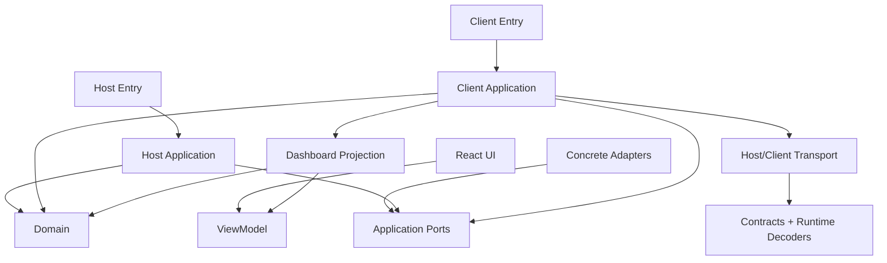

# dsh-billing-card 2.0：候选重建架构

> 阶段：方案建议，不含实现  
> 输入：产品逆向、代码质量、当前架构和 API 清单  
> 标记：**[事实]** 当前已证实约束；**[推断]** 方案评价；**[建议]** 推荐设计或迁移方向

## 1. 重建目标与评价标准

### 1.1 本轮要解决的实际问题

**[事实]** 当前主要问题不是缺少功能，而是：

- 外部输入校验不一致，已有崩溃、少算和币种误标路径。
- 启动、定时、事件和手动刷新各自实现状态机，存在阻塞与乱序覆盖。
- DTO 无版本，loading／失败／协议缺失等语义模糊。
- `client.js` 同时承载领域、DSH 适配、异步和 UI，纯规则不能独立导入。
- 真实浏览器、真实 DSH 和异步组合未进入现有测试。

### 1.2 评价标准

**[建议]** 方案按以下优先级比较：

1. 金额、币种、付款方和计费状态的正确性。
2. 对已证实 DSH 能力的适配程度，以及无 Web Server 时的降级能力。
3. 依赖方向、测试独立性和后续修改成本。
4. 新旧 Host/Client 共存与回滚成本。
5. 扩展能力是否与真实产品规模匹配，避免预先建设平台。

### 1.3 不应误当成事实的假设

- **[事实]** 当前只有 Client 被证明能读账号、模型目录和可见会话；Host 只被证明能读凭据和上游。
- **[事实]** 当前规则禁止构建和 bundler，但用户已允许 2.0 重议工程规范；是否引入仍是负责人决策。
- **[推断]** “TypeScript 能解决路由坏数据”“Host 天然知道浏览器当前会话”“统一 source 接口适合所有业务”都不成立或尚未证明。

## 2. 方案 A：契约优先的分层双端模块化单体

**[建议] 推荐方案。** 核心不是简单 TypeScript 化，而是共享纯领域内核、版本化运行时契约、Client Application 协调层和视图模型驱动 UI；轻量构建仍产出 DSH 需要的 Host/Client 两个入口。

### 2.1 模块划分

```text
src/
  contracts/
    host-v1                 # 旧 DTO 兼容 decoder，仅迁移期需要
    host-v2                 # 版本化 DTO、运行时 decoder、revision
    errors                  # 传输、协议、来源、配置错误分类
  domain/
    money                   # 十进制解析、同币种合计、截断
    billing-period          # 北京日期、峰谷、下一边界
    pricing                 # 模型规范化、alias、价格选择
    provider-policy         # 官方价目与付款方规则
    balance-selection       # 正常与降级路径的显式决策
    snapshots               # 每源快照选择、覆盖范围与过期语义
  application/
    dashboard-projection    # 纯函数：输入状态 -> 展示中立 ViewModel
    dashboard-controller    # Client 启动、订阅、刷新、销毁、latest-wins
    host-snapshot-service   # Host 每源加载、独立提交、刷新协调
    ports                   # Account/Catalog/Selection/Clock/Transport 等接口
  adapters/
    deepseek                # 价目和余额 HTTP、纯解析器
    calendar-icloud         # ICS 适配器
    dsh-host                # credentials、logger、webServer、effect
    dsh-client              # account、session、selection、locale、events、timer
    http-client             # Host DTO 获取、取消、协议协商
  ui/
    billing-card            # 只消费 ViewModel
    tooltip                 # 触发器、ARIA、动态真相与定位
    placement               # 宿主布局适配，隔离负 margin 等策略
    formatting              # Intl、币种、时长
    styles                  # tokens、组件样式
    locales                 # zh/en 文案
  entries/
    host                    # Host composition root
    client                  # Client composition root + ModuleLoader 包装
```

### 2.2 模块职责

| 层 | 负责 | 禁止负责 |
| --- | --- | --- |
| Contracts | DTO 版本、运行时校验、兼容 fixture、错误码 | 业务决策、React、网络 |
| Domain | 金额、计费、provider、价格、余额与快照规则 | I/O、DOM、Cordis、隐式系统时间 |
| Application | 用例状态机、请求顺序、每源提交、视图投影 | 具体 fetch/DSH/React 实现 |
| Adapters | DSH、HTTP、凭据、日历、浏览器能力 | 跨适配器业务规则 |
| UI | ViewModel 渲染、格式化、tooltip、可访问性 | 直接读 DSH、直接请求路由、金额计算 |
| Entries | 依赖装配和宿主生命周期 | 重复实现领域逻辑 |

### 2.3 依赖方向



**[建议]** Domain 不依赖任何外层；UI 只依赖 ViewModel 和格式化；具体 DSH 服务只出现在 adapters／entries。传输 DTO 经 decoder 转为内部对象后才进入 Domain，不能把 DTO 类型直接当成所有内部模型。

### 2.4 数据流

```text
Host 上游
  -> 专用解析与校验
  -> 每源独立状态、observedAt、revision、provenance
  -> 版本化 Host DTO
  -> Client Transport + Decoder
                                      ┐
DSH account/catalog/selection/events -> Client Ports ├-> Dashboard Controller
locale + clock + built-in snapshots                  ┘          |
                                                                v
                                                  pure Dashboard Projection
                                                                |
                                                                v
                                                       React ViewModel
```

**[建议]** 倒计时继续由 Client 本地按秒计算；账号和可见会话继续由 Client adapter 读取；Host 不需要参与每秒刷新，也不需要保存浏览器会话。

### 2.5 API 设计思路

- **[建议]** 新 v2 路由与旧路由并存一个明确兼容期；新 Client 按“v2 -> v1 -> 内置快照”降级。若坚持同一路由升级，则必须证明所有变化对旧 Client 都是兼容增量。
- **[建议]** v2 至少包含：
  - `schemaVersion` 和可比较的快照 `revision`。
  - 每源独立的 `status`、`observedAt`、`errorKind`、`provenance`。
  - 明确 `unloaded/loading/ready/unavailable/failed/partial/stale`，不用 null 表示全部语义。
  - 金额十进制字符串，未知币种和不完整必需字段拒绝。
- **[建议]** 普通 read 与强制 refresh 在 API 语义上分离；是否使用独立命令端点由 Web Server 安全和宿主能力决定。
- **[建议]** 包级公共 API 默认只保留 Host/Client 入口、locale 和 icon；Domain／parser 是否公开另行决定。
- **[建议]** 内部 ports 保持少量明确接口：`AccountPort`、`CatalogPort`、`SelectionPort`、`UpstreamEvents`、`BillingSnapshotPort`、`Clock`。

### 2.6 状态与一致性设计

**[建议]**

- Host 价目、日历、余额各自独立加载和提交，避免一个凭据 Promise 阻塞所有来源。
- 所有启动、定时、事件和手动刷新进入同一资源协调器。
- 按资源采用 single-flight 或 latest-wins；旧 generation 不得覆盖新 generation。
- Client 请求支持超时、取消和销毁保护；会话切换同时使旧选择相关响应失效。
- 明确最后有效值策略：失败时撤下，或保留并标 stale，不能注释与代码各说一套。
- ViewModel 更新后，已打开 tooltip 必须同步更新或关闭。

### 2.7 扩展方式

**[建议]**

- 新上游：新增目标明确的 adapter 和相应契约，不建立通用任意 URL 代理。
- 新官方 provider：修改显式 Domain policy 与反例，不做模糊 substring 匹配。
- 新卡片事实：先扩展 ViewModel，再改 UI；避免组件直接读取新 DSH 服务。
- 新 DSH 能力：新增 Application Port 和 adapter，而不是把全局对象传入 Domain。

这是代码级扩展，不是第三方动态插件平台；对当前一张卡片的规模更合适。

### 2.8 测试策略

| 层 | 测试 |
| --- | --- |
| Domain | 确定性单元测试、完整峰谷边界、金额性质测试、provider／降级矩阵 |
| Contracts | 畸形输入、原型键、未知币种、未知版本、旧新 DTO、decoder 上限 |
| Host Application | 假时钟／假网络、凭据 pending、启动与定时交错、旧响应覆盖、服务撤销 |
| Client Application | 乱序、重复事件、快速会话切换、卸载后返回、晚注入服务 |
| UI | ViewModel 驱动组件测试；真实浏览器 tooltip／布局／ARIA／主题 |
| 产物与宿主 | 两个真实构建产物 smoke、tarball、Loader 格式、最低／目标 DSH E2E |

**[建议]** 保留现有 1004 条中有业务价值的反例，但不要把“断言数不下降”机械迁移为重复实现测试；应按契约覆盖矩阵迁移并记录每项去向。

### 2.9 工程方式

**[建议]** 推荐 TypeScript + 轻量 bundler 作为**开发依赖**，继续保持无新增运行时 npm 依赖。构建必须产出两个自包含入口，Client 仅把 React 留作宿主外部依赖；不得生成 DSH Loader 无法加载的共享 chunk 或裸 import。

**[推断]** 若负责人坚持零构建，可退化为 ES modules + JSDoc `checkJs` 的单文件 Client 变体，但仍需 Contracts／Application／Domain 的逻辑分层；在不允许 bundler 且 Loader 不支持相对 ESM 的前提下，物理拆分会受限，维护性收益较小。

### 2.10 成本与风险

- **复杂度：[推断] 中。** 模块和构建增加，但无通用平台运行时。
- **维护成本：[推断] 三者最低。** 领域、异步和 UI 可独立演进。
- **迁移风险：[推断] 中。** 主要是构建产物兼容、旧新半部组合和测试迁移，而不是业务规则本身。
- **前置条件：[事实／建议]** 必须正式批准工程约束变化，并先验证真实 Loader 产物。

## 3. 方案 B：Host BFF 聚合仪表盘，薄 Client

核心是把账号、目录、选择、上游和领域投影都迁到 Host，Host 输出展示中立 Dashboard ViewModel；Client 只负责本地时钟、格式化、翻译和渲染。

### 3.1 前置可行性阻断

**[事实]** 当前仓库不能证明 Host 能：

1. 读取与浏览器一致的账号余额和登录状态。
2. 读取完整模型目录和 provider 信息。
3. 获取或订阅某个 Client 的可见会话、provider/model 选择。
4. 区分多个浏览器实例、多个会话和账号切换。

**[建议]** 这些能力必须在最低和目标 DSH 版本上用可运行证明验证后，B 才能立项；不能从 Host 存在 Cordis 服务推断它知道浏览器当前选择。

### 3.2 模块划分

```text
src/
  contracts/               # BFF snapshot、context revision、错误和版本
  domain/                  # 与 A 相同的纯规则
  host/
    upstream-adapters
    dsh-account-gateway
    dsh-catalog-gateway
    client-context-registry # 按 Client/Session 隔离
    dashboard-aggregator
    refresh-coordinator
    bff-routes / events
  client/
    bff-transport
    clock-and-countdown
    formatting-and-locales
    card-renderer
    tooltip-and-placement
```

### 3.3 依赖方向与数据流

```text
Client context registration
  -> Host Client Context Registry
  -> Host Dashboard Aggregator
  -> DSH + upstream ports
  -> Domain projection
  -> per-client/per-session versioned Dashboard VM
  -> Client formatting + rendering
```

**[建议]** 若 Host 不能订阅可见选择，Client 必须在选择变化时上报 `{clientId, sessionId, provider, model, selectionRevision}`。Host 不得把账号或选择放入当前全局单例 state；响应必须带 `contextRevision` 防止旧会话覆盖新会话。

### 3.4 API 设计思路

- **[建议]** 按客户端／会话隔离的 dashboard snapshot，而不是当前全局数据快照。
- **[建议]** 可有独立 refresh 命令或事件流；每次响应带 schema revision 和 context revision。
- **[建议]** Host 输出展示中立语义，不输出完全本地化字符串，也不每秒生成倒计时文本。
- **[建议]** API Key 永不进入 DTO 或日志；账号数据的缓存、可见范围和生命周期需要单独安全决策。

### 3.5 扩展方式

**[推断]** 新余额来源和 provider 规则集中在 Host，是 B 的主要优势；但新 UI 字段仍需同步修改 Host DTO 和 Client，不会自动减少所有改动。若某类 Client 上下文 Host 无法获取，就会退回 Client 读取并形成混合架构。

### 3.6 测试策略

除 A 的大部分测试外，必须新增：

- 两个浏览器实例、多会话、快速切换和不同账号的数据隔离。
- Client context 迟到、过期、注销和 Host 缓存清理。
- Host/Client revision 不一致和旧响应丢弃。
- 各支持 DSH 版本的真实能力契约。
- 无 Web Server 时的完整产品降级。

### 3.7 成本与风险

- **复杂度：[推断] 高。** 增加上下文注册、按客户端缓存、身份隔离和更多生命周期。
- **维护成本：[推断] 高。** Host 深耦合 DSH 内部 UI／会话模型，升级敏感。
- **迁移风险：[推断] 高。** 迁移期可能同时保留 Client 领域逻辑和 Host BFF，短期更厚。
- **降级风险：[推断] 高。** 无 Web Server 时完整 BFF 不可用；若要求功能不降级，就要在 Client 保留第二套领域实现。
- **建议结论：** 只在 Host 能力验证通过、确有服务端多视图聚合需求时重新评估；当前不推荐。

## 4. 方案 C：通用 provider/source 插件平台

核心是把余额、价格、日历和 UI 贡献抽象为可独立发布的 SPI 与适配器，由注册表和事件管线组合。

### 4.1 模块划分

```text
platform/
  plugin-manifest           # 版本、能力、权限
  registry-and-lifecycle
  source-spi                # source envelope、revision、状态
  provider-policy-spi
  credentials-and-permissions
  refresh-and-event-pipeline
  dashboard-contributions
  ui-schema                 # 受控 UI 扩展
  contract-test-kit
adapters/
  deepseek-balance
  deepseek-pricing
  icloud-calendar
  dsh-account
  dsh-catalog
```

### 4.2 依赖方向

```text
Composition Root -> Registry / Platform Kernel
Third-party Adapter -> Stable SPI only
Domain-specific Contract -> Independent versioned package
UI Contribution -> Declarative UI Contract
```

**[建议]** 插件之间不得互导实现，平台不得依赖具体 DeepSeek adapter。统一 envelope 可以包含 `sourceId/status/observedAt/revision`，但 payload 必须按价格、余额、日历分族，不能退化为 `payload:any` 加大量条件分支。

### 4.3 数据流与 API 设计

```text
Source Plugin
  -> Source Envelope
  -> Validation / Permission Boundary
  -> Registry / Event Pipeline
  -> Domain Projection
  -> Dashboard / UI Contributions
```

**[建议]** SPI 还需定义插件版本、宿主兼容范围、刷新与订阅能力、密钥权限、允许网络目标和 UI 安全边界；不能默认可执行任意浏览器代码或把 Host 变成任意 URL 代理。

### 4.4 扩展方式

**[推断]** 三者中扩展最强，适合多团队、来源频繁增加、独立发布和真实第三方生态。如果只是“以后也许多一个余额来源”，收益不足。

### 4.5 测试策略

- 所有 adapter 运行统一 SPI 契约测试。
- 插件清单、版本、权限、恶意数据和故障隔离测试。
- 插件组合和升级矩阵。
- UI schema 兼容与安全测试。
- 平台和每个 adapter 独立发布验证。

### 4.6 成本与风险

- **复杂度：[推断] 很高。** 先建平台，再实现原卡片。
- **维护成本：[推断] 很高。** SPI 一旦发布就形成长期兼容负担。
- **迁移风险：[推断] 很高。** 容易在抽象未稳定时同时迁移采集、领域、UI 和加载机制。
- **建议结论：** 当前不采用；只有负责人确认第三方 provider/source 生态是 2.0 核心目标时才进入设计。

## 5. 横向比较

| 维度 | A：分层模块化单体 | B：Host BFF | C：通用插件平台 |
| --- | --- | --- | --- |
| 当前可行性 | 高 | 未证实，有阻断项 | 技术可行但需求不足 |
| 匹配已证实 Host/Client 能力 | 高 | 低至未知 | 中 |
| 解决输入与 DTO 问题 | 是 | 是，但新增上下文契约 | 取决于平台设计 |
| 解决异步竞态 | 是 | 是，但新增 context 竞态 | 取决于管线设计 |
| 无 Web Server 降级 | 可保留 | 难保留完整能力 | 取决于实现 |
| 多客户端风险 | 低 | 高 | 中至高 |
| 扩展能力 | 足够的代码级扩展 | 集中式扩展 | 最强 |
| 构建／运行复杂度 | 中 | 高 | 很高 |
| 维护成本 | 中低 | 高 | 很高 |
| 迁移风险 | 中 | 高 | 很高 |
| 建议 | **采用** | 能力验证后再议 | **当前不采用** |

## 6. 推荐方案与理由

**[建议] 推荐 A，理由如下：**

1. 直接对应当前已发现的输入、状态机、DTO 和巨组件问题，而不是把问题搬到另一侧。
2. 不依赖尚未证实的 Host 账号／目录／可见会话能力。
3. 能保留 Key 仅在 Host、倒计时在 Client、无 Web Server 使用内置快照的合理边界。
4. 可渐进抽取并保留现有业务反例，不必同时重写所有 UI 和宿主适配。
5. 不提前承担 B 的多客户端上下文和 C 的 SPI 长期兼容成本。

**[推断]** A 的成功条件不是文件数量，而是依赖方向和运行时契约真正执行；如果只把 `client.js` 切成多个仍互相读全局状态的文件，复杂度会更高而收益很低。

## 7. 建议迁移顺序（仅方案，不实施）

1. **[建议] 行为定型**：保留金额、峰谷、provider、快照和新旧半部组合的 characterization；补入本次发现的反例。
2. **[建议] 契约与 Domain**：先抽纯规则和 decoder，保持现有入口行为不变。
3. **[建议] Client Controller 与 Ports**：统一启动、订阅、定时、强制刷新和销毁。
4. **[建议] Host Snapshot Service**：每源独立提交，统一余额 generation／single-flight。
5. **[建议] UI 拆分**：ViewModel 驱动卡片，tooltip／placement／ARIA 独立。
6. **[建议] 构建与产物门禁**：验证两个真实入口、Loader、tarball 和无新增运行时依赖。
7. **[建议] v2 契约与兼容期**：按负责人批准的矩阵启用，最后才删除旧路径或旧字段。

## 8. 方案阶段不做的事项

**[事实]** 本报告没有创建新架构代码、修改 manifest、引入依赖、改变路由或开始迁移。

**[建议]** 在负责人确认产品保留项、兼容矩阵、工程依赖、Host 能力和发布策略前，不进入实现。决策清单见 [REBUILD_DECISIONS.md](REBUILD_DECISIONS.md)。
